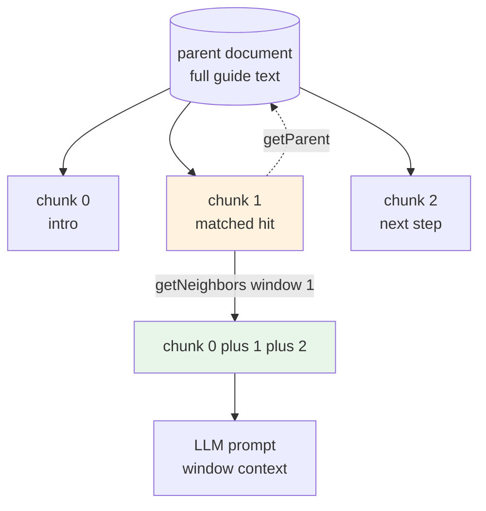
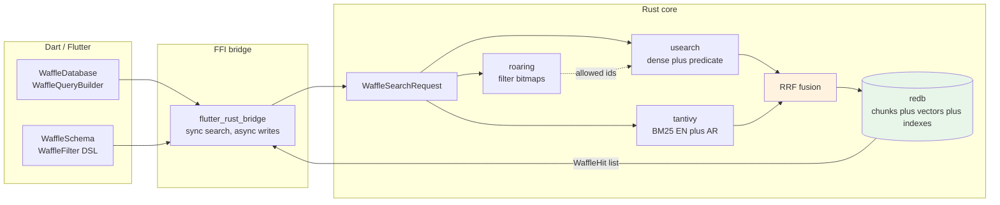
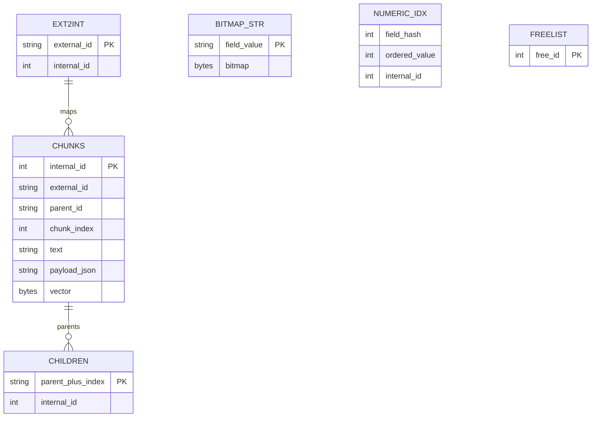
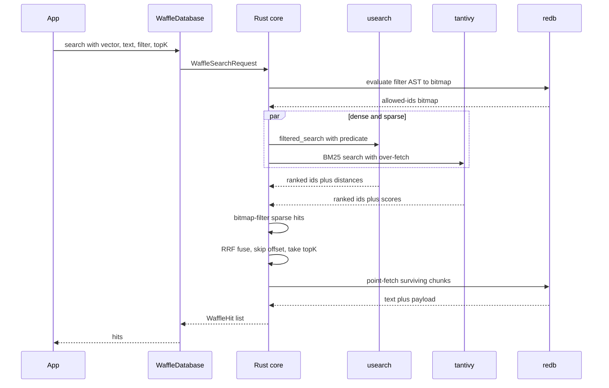
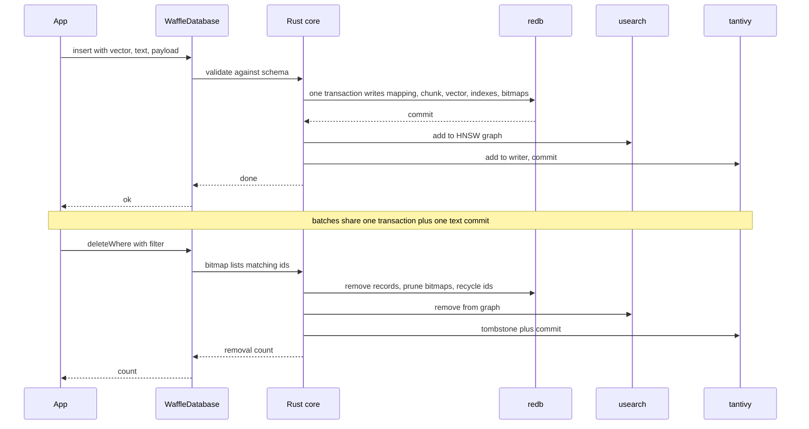
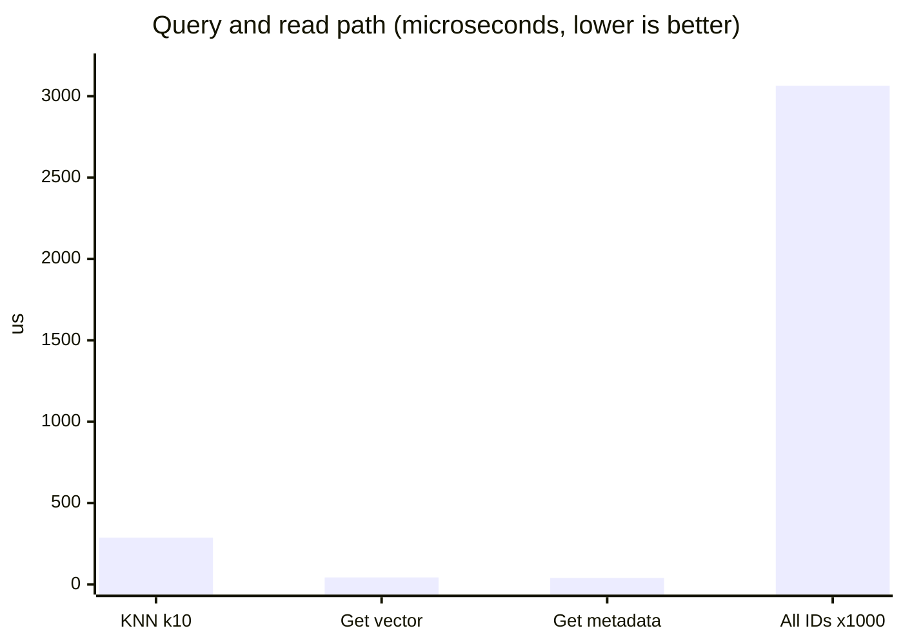
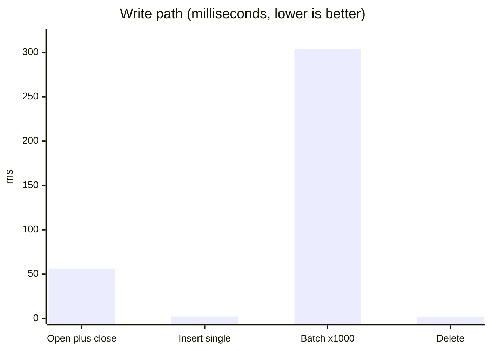

<h1 align="center">Waffle-DB</h1>
<p align="center">
  
</p>

<p align="center">
  <strong>A local database for Flutter combining dense vector search, full-text search and filtered storage in one Rust engine.</strong><br>
  Built for on-device RAG: chunked documents, hybrid retrieval and metadata pre-filtering without a server.
</p>

<p align="center">
  <a href="https://pub.dev/packages/waffle_db"></a>
  <a href="https://pub.dev/packages/waffle_db/score"></a>
  
  
  <a href="LICENSE"></a>
</p>

> **Development preview (`0.1.0-dev.1`):** this is a trial release for early feedback. The public API may still change before the first stable version  pin the exact version in your `pubspec.yaml` and report anything that breaks.

<p align="center">
  <a href="#-key-features">Key Features</a> •
  <a href="#-why-waffle-db">Why?</a> •
  <a href="#-installation">Installation</a> •
  <a href="#-basic-usage">Basic Usage</a> •
  <a href="#-advanced-usage">Advanced Usage</a> •
  <a href="#-architecture">Architecture</a> •
  <a href="#-showcase-demo">Showcase Demo</a> •
  <a href="#-performance-benchmarks">Benchmarks</a> •
  <a href="#-contributing">Contributing</a>
</p>


## ✨ Key Features

| Area | What you get |
| :--- | :--- |
| **Retrieval** | Dense k-NN, BM25 keywords (EN+AR stemming), and RRF hybrid fusion with alpha blending and offset pagination |
| **Filtering** | `eq`/`in`/`and`/`or` pre-filters evaluated as bitmap predicates during search  never after it |
| **Storage** | ACID transactions, dual String↔u32 ID mapping with FreeList recycling, crash recovery by index rebuild |
| **Chunks** | Parent/neighbor window context for LLM prompts, batch upserts, filtered bulk deletes |
| **Collections** | Logical namespaces backed by an indexed `_collection` pre-filter, so searches never leak across collections |
| **DX** | Mandatory versioned schemas, fluent query builder, UUIDv7 ID helper, measured (not claimed) benchmarks |

---

## 🤔 Why Waffle-DB?

> AI features need more than key-value storage: similarity over embeddings, keyword match over text, and filters that actually constrain the search.

General-purpose local databases (SQLite, Hive) have no vector index, and pure-Dart vector search does linear scans that get slow past a few thousand embeddings. WaffleDB keeps a native HNSW graph, a BM25 inverted index and filter bitmaps on device, so retrieval-augmented flows run locally with predictable latency.

### 📊 How we compare

| Feature | Standard Local DB | Pure Dart Vector DB | **Waffle-DB** |
| :--- | :---: | :---: | :--- |
| **Engine** | SQLite / Hive | Dart | **Rust native core** |
| **Dense Indexing** | Linear scan | Linear / LSH | **HNSW graph (`usearch`)** |
| **Sparse Indexing** | ❌ | ❌ | **BM25 full-text (`tantivy`, EN+AR)** |
| **Hybrid Search** | ❌ | ❌ | **Dense + sparse with RRF fusion** |
| **Filtered Search** | SQL WHERE | Post-filter in Dart | **Pre-filtering (`roaring` bitmaps)** |
| **Storage Guarantees** | ACID | ❌ | **ACID (`redb`)** |
| **Chunk Relations** | Manual joins | Manual | **Parent/neighbor chunk APIs** |
| **FFI Model** | — | — | **Sync search, async writes** |
| **Vector Dimensions** | ❌ | Limited | **Arbitrary (tested 3–1536)** |

### 🛠️ Tech Stack

* **Host Languages**: Dart 3.4+ (Flutter) & Rust 1.75+
* **Bridge Engine**: `flutter_rust_bridge` v2.13.0
* **Vector Engine**: `usearch` (HNSW with predicate pre-filtering; `numkong` SIMD backend off for Android NDK compatibility)
* **Text Engine**: `tantivy` (BM25 inverted index, English + Arabic stemming, positions indexed)
* **Storage Engine**: `redb` (embedded ACID database)
* **Filter Engine**: `roaring` (compressed bitmaps for metadata filtering)
* **Parallelism**: `rayon` (dense+sparse queries run side by side)
* **Error Handling**: `anyhow` (single error type, surfaced as strings over FFI)
* **Dart Side**: `uuid` (external String IDs)

> [!NOTE]
> Databases created by pre-0.1.0 releases (`sled` engine) are incompatible and require a reindex. There is no auto-migration by design.

---

## 📦 Installation

> [!TIP]
> **Don't worry about the "Rust Core"!**
> Adding **Waffle-DB** to your project is designed to be as simple as adding any other Flutter package. While it uses a high-performance Rust engine, you don't need to be a Rust expert or manage complex builds manually. You just install the language once, and the library handles all the heavy lifting, compiling itself automatically for whatever platform (Android, iOS, macOS, Windows, Linux) or architecture you are targeting.

### 1. Prerequisites (The Rust Toolchain)

Since this library uses a high-speed bridge to connect Flutter and Rust, you need the Rust compiler installed on your development machine.

- **Windows**: Download and run [rustup-init.exe](https://rustup.rs).
- **macOS / Linux**: Run the following command in your terminal:
  ```bash
  curl --proto '=https' --tlsv1.2 -sSf https://sh.rustup.rs | sh
  ```

> [!IMPORTANT]
> Once Rust is installed, the build system will automatically detect your Flutter target and compile the Rust core into a high-performance native shared library. You only need to set this up once!

### 2. Add the Dependency

Add the package to your `pubspec.yaml`:

```yaml
dependencies:
  waffle_db: ^0.1.0
```

---

## 🚀 Basic Usage

### 1. Initialization

Initialize the library in your `main()` function before starting the app.

```dart
import 'package:flutter/material.dart';
import 'package:waffle_db/waffle_db.dart';

Future<void> main() async {
  WidgetsFlutterBinding.ensureInitialized();
  // Load the native Rust binary into memory
  await WaffleDB.init();
  
  runApp(const MyApp());
}
```

### 2. Configuration & Opening the Database

For a great Developer Experience (DX), WaffleDB comes with built-in configuration profiles tailored to common needs:

| Profile | What it tunes |
| :--- | :--- |
| **`mobileProfile`** | Small graph (`m: 12`), 16MB cache, 50k element capacity. |
| **`serverProfile`** | Deeper graph (`m: 32`, `ef_search: 64`), 512MB cache, 5M capacity. |
| **`readHeavyProfile`** | High-recall search (`ef_construction: 200`, `ef_search: 128`), 2GB cache, all CPU cores, 10M capacity. |
| **`writeHeavyProfile`** | Cheap construction (`ef_construction: 32`), 128MB cache, 20M capacity. |

> [!NOTE]
> The `useQuantization` flag is currently reserved and has no effect: vectors are stored as full-precision floats. Profiles differ in graph shape, cache size and capacity.

Configure and open your high-speed vector store using a profile (or customize with the `copyWith` extension):

```dart
import 'dart:typed_data';
import 'package:waffle_db/waffle_db.dart';
import 'package:path_provider/path_provider.dart';

Future<void> runVectorStore() async {
  final dir = await getApplicationDocumentsDirectory();
  final dbPath = '${dir.path}/my_vectors';

  // For a great Developer Experience (DX), WaffleDB comes with built-in 
  // configuration profiles tailored to common needs:
  
  // Example 1: Use a pre-optimized mobile profile
  var config = await WaffleConfig.mobileProfile(
    path: dbPath,
    dimension: 128, // Your vector dimension
  );

  // Example 2: You can also use other profiles like `readHeavyProfile`, 
  // `writeHeavyProfile`, or `serverProfile`. 
  // Need to tweak a specific setting? Use the `copyWith` extension!
  config = await WaffleConfig.readHeavyProfile(
    path: dbPath,
    dimension: 1536, // OpenAI dimensions
  ).copyWith(
    workerThreads: 8, // Tweak only what you need
    cacheSizeBytes: BigInt.from(128 * 1024 * 1024),
  );

  // Alternatively, you can define everything manually:
  /*
  final manualConfig = WaffleConfig(
    dimension: 128,
    path: dbPath,
    graphConfig: const WaffleGraphConfig(
      m: 16,
      metric: WaffleMetric.cosine,
      efConstruction: 64,
      efSearch: 32,
    ),
    maxElements: 100000,
    useQuantization: false,
    cacheSizeBytes: BigInt.from(32 * 1024 * 1024),
    workerThreads: 4,
  );
  */
  
  final db = await WaffleDatabase.open(config, schema: schema);
}
```

The schema is mandatory and versioned. Indexed fields get `roaring` bitmaps for true pre-filtering; everything else rides along as free payload:

```dart
final schema = WaffleSchema(
  fields: [
    WaffleFields.string('category'),
    WaffleFields.integer('price'),
    WaffleFields.string('notes', indexed: false),
  ],
  textLanguage: WaffleLanguage.english, // or .arabic for Arabic stemming
);
```

### 3. Inserting Data (Single & Batch)

Vectors, text and structured payload go in together. Indexed payload fields are validated against the schema and maintained in the filter indexes.

**Single Insert:**
```dart
await db.insert(
  'unique_id_1',
  Float32List.fromList([0.1, 0.2, ...]),
  text: 'Noise-cancelling wireless headphones',
  payload: {'category': 'electronics', 'price': 299},
);
```

**Batch Insert:**
```dart
final records = [
  WaffleRecord.fromList(
    id: 'id_1',
    vector: [0.1, 0.2, ...],
    text: 'Chunk 0 of the manual',
    payload: {'category': 'docs', 'price': 0},
    parentId: 'manual-1',
    chunkIndex: 0,
  ),
  WaffleRecord.fromList(id: 'id_2', vector: [0.3, 0.4, ...]),
];
await db.insertBatch(records);
```

### 4. Querying & Query Builder

WaffleDB offers dense search, keyword search and fused hybrid search through one API. Filters are pushed into the engine as bitmap predicates  never applied after the fact.

**Dense + pre-filter:**
```dart
final results = db.search(
  vector: queryVector,
  topK: 5,
  filter: WaffleEqFilter('category', 'electronics'),
);
for (var hit in results) {
  print('Found ${hit.id} with score ${hit.score}');
}
```

**Hybrid (meaning + keywords, fused with RRF):**
```dart
final results = await WaffleQueryBuilder(db)
    .withHybrid(vector: queryVector, text: 'wireless headphones')
    .eq('category', 'electronics')
    .alpha(0.7)
    .limit(10)
    .efSearch(64)
    .execute();
```

#### Fluent API Methods Reference

| Method | Description |
| :--- | :--- |
| `withVector(Float32List vector)` | Sets the dense query vector. |
| `withVectorList(List<double> vector)` | Sets the dense query vector from plain doubles. |
| `withText(String text)` | Sets the BM25 keyword query. |
| `withHybrid({vector, text})` | Sets both sides of a hybrid query. |
| `limit(int n)` | Caps returned hits (default `10`). |
| `offset(int n)` | Skips the first `n` fused hits for pagination. |
| `efSearch(int ef)` | Overrides index expansion for this query (`0` = config default). |
| `alpha(double a)` | Blends dense vs sparse ranks in hybrid mode (default `0.5`). |
| `rrfK(int k)` | RRF smoothing constant (default `60`). |
| `eq(field, value)` / `inList(field, values)` | Pre-filters evaluated as bitmap predicates. |
| `filter(WaffleFilter f)` / `and(List)` / `or(List)` | Combines pre-built filters. |
| `execute()` | Runs the query and returns fused `WaffleHit` results. |

---

## 🔬 Advanced Usage

### Namespacing with `WaffleCollection`

Collections scope IDs (`collectionName::id`) and searches: every member carries an indexed `_collection` field, so collection search is a pre-filter, not a post-filter. The schema must declare it:

```dart
final schema = WaffleSchema(
  fields: [WaffleFields.string('_collection'), /* ... */],
  textLanguage: WaffleLanguage.english,
);
final documents = WaffleCollection(db, 'documents');

await documents.add('doc1', queryVector);
await documents.addBatch([...]);

final searchResults = await documents.search(queryVector, topK: 5);
```

### Managing Data (CRUD Operations)

WaffleDB provides full support for managing records beyond basic insert and query.

```dart
// Check total elements
final count = db.count();

// Retrieve all IDs
final allIds = db.getAllIds();

// Get the original vector or payload
final vector = db.getVector('unique_id_1');
final payload = db.getPayload('unique_id_1');

// Expand a chunk hit into window context for the LLM
final neighbors = db.getNeighbors('chunk-3', window: 1);
final parent = db.getParent('chunk-3');

// Insert or replace in one call (reports whether it replaced)
final replaced = await db.upsert('unique_id_1', vector);

// Delete physically removes the record from every engine
await db.delete('unique_id_1');
await db.deleteBatch(['a', 'b']);

// Wipe one category, then bulk-load fresh documents (re-index)
await db.deleteWhere(WaffleEqFilter('category', 'stale'));

// Force flush all pending writes to disk
await db.flush();

// Close the database safely
await db.close();
```

### Chunk context for LLM prompts



### Bringing Your Own Embeddings

WaffleDB stores vectors; it does not embed text. Use any embedding model (a local ONNX model, OpenAI, Gemini) to produce `Float32List` vectors of the configured dimension, then insert and query with them. The `example/` app ships a tiny hashed trigram embedder purely so the demos run offline  it captures lexical overlap, not meaning, and should be replaced by a real model in production apps.

### Pre-filtering & Payloads

Filters are evaluated to compressed bitmaps before any distance is computed, so constrained queries never come back empty when matches exist deeper in the ranking.

```dart
await db.insert(
  'product-42',
  vector,
  text: 'Noise-cancelling wireless headphones',
  payload: {'category': 'electronics', 'price': 299},
);

final results = db.search(
  vector: queryVector,
  topK: 5,
  filters: [
    WaffleEqFilter('category', 'electronics'),
    WaffleInFilter('price', [199, 299]),
  ],
);
```
---

## 🧠 Architecture

One database file set, four cooperating engines:

| Engine | Crate | Responsibility |
| :--- | :--- | :--- |
| **Vector** | `usearch` | Dense k-NN over an HNSW graph with predicate pre-filtering during traversal |
| **Text** | `tantivy` | BM25 keyword search with per-collection English/Arabic tokenizers |
| **Storage** | `redb` | Chunks, vectors, ID mappings, bitmaps and indexes in ACID transactions |
| **Filter** | `roaring` | `field=value → bitmap` indexes; one `AND`/`OR` pass produces the allowed-ID set |

Design decisions:

* **Strict schema + free payload**  indexed fields are declared up front (`WaffleSchema`); anything else rides along unindexed in the payload.
* **Dual ID mapping**  developers use external `String` IDs (UUIDv7, Firebase IDs); the engine maps them to dense internal `u32` keys. Deleted keys recycle through a FreeList.
* **Buffered writes + explicit flush**  single inserts commit immediately; batches share one storage transaction and one text commit; `flush()` persists the vector index.
* **Unified hybrid query**  one request carries `vector?`, `text?`, filter AST, `alpha`, RRF constant and pagination; dense + sparse run in parallel and fuse via RRF inside Rust. The sparse side over-fetches and applies the same allowed-IDs bitmap.
* **True delete**  physical removal from the graph, text tombstones, storage cleanup and bitmap pruning in one path shared by single, batch and filtered deletes.

### Engine architecture



### Storage layout

Eight `redb` tables hold everything; keys are shown with their sort order:




### How a Search Flows

1. Dart builds a `WaffleSearchRequest` (vector and/or text, top-k + offset, filter AST).
2. Rust compiles the filter AST into one `RoaringBitmap` from the stored bitmaps and the ordered numeric index.
3. `rayon::join` runs the `usearch` filtered search and the `tantivy` BM25 search concurrently.
4. RRF fuses the two ranked lists (`alpha`-weighted, default 0.5/60); offset pagination applies to the fused list.
5. Chunk records for the surviving IDs are point-fetched from `redb` and returned as `WaffleHit`s with text and payload.

### Search flow



### How a Write Flows

1. Payload is validated against the schema (indexed fields required, types checked).
2. One `redb` transaction writes the ID mapping, chunk bytes, vector bytes, children entry, numeric entries and bitmap updates.
3. The vector is added to the HNSW graph; text goes to the `tantivy` writer (committed per single insert, once per batch, or on `flush()`/`close()`).
4. Duplicate external IDs are rejected on insert; `upsert` replaces explicitly.

### Write lifecycle



### Current Limitations

* Filters support `eq`/`in`/`and`/`or` only  no `NOT`, no range comparisons yet (the numeric index layout already supports them; tracked for v1.1).
* No auto-migration between storage formats; open with a mismatched schema or dimension fails loudly.
* One writer at a time; concurrent reads are fine.
* Flutter Web is not supported in v1 (native engines have no WASM builds).
* Text indexes store positions; databases created before positions were enabled need a fresh path.

### 🗺️ Roadmap

1. **Core replacement** (done in 0.1.0): `redb` + `usearch` + dual mapping + strict schema. Breaking: old databases are incompatible.
2. **Filtering + text** (mostly done): bitmap filters, numeric index (EQ/IN), EN/AR tokenizers, parent/neighbor chunk APIs. Left: range filters.
3. **Next**: local embedding adapter, `waffle_db_langchain` bridge package, range filters, recall benchmarks incl. Arabic eval.

---

## 🖥️ Showcase Demo

`example/` is a Flutter application exercising the public API only:

| # | Demo | Everyday story | Technique |
| :--- | :--- | :--- | :--- |
| 1 | **Colors** | Find paints matching a target shade | Dense Euclidean k-NN, up to 12M vectors |
| 2 | **Docs RAG** | Answer questions from guides with citations | Chunked docs, hybrid retrieval, section pre-filters, window context |
| 3 | **Code Search** | Jump to a symbol definition | Exact keyword match, language/kind pre-filters, file context |
| 4 | **Support** | Triage an incoming ticket, resolve it, sweep resolved ones | Priority/status pre-filters, upsert-to-resolve, deleteWhere |
| 5 | **Glossary** | Look up a term in English or Arabic | Bilingual stemming search, domain pre-filters |

Dense vectors in the demos come from a tiny hashed-trigram embedder (`demo_embed.dart`) so everything runs offline  see “Bringing Your Own Embeddings” before shipping.

Headless versions of the flows live in `example/integration_test/ai_demos_test.dart` and run with `flutter test integration_test`.

---

## 🏎️ Performance Benchmarks

Measured on the current engine (Linux x64, debug build) via `flutter test`. Writes cost more than a bare key-value store because every insert commits a storage transaction and single inserts also commit the text index; deletes remove data from all three engines. Queries stay sub-millisecond.

### Core Operation Latencies

| Database Operation | Average Latency | Throughput |
| :--- | :---: | :---: |
| **Database Open & Close** | 56.54 ms | ~18 cycles/sec |
| **Insert Single Vector (128-dim)** | 2.36 ms | ~420 inserts/sec |
| **Insert Batch (1,000 vectors)** | 303.84 ms | ~3,290 vectors/sec |
| **Query KNN (k=10, efSearch=32)** | 0.29 ms | ~3,460 queries/sec |
| **Get Vector by ID** | 0.043 ms | ~23,000 reads/sec |
| **Get Metadata by ID** | 0.040 ms | ~25,000 reads/sec |
| **Delete Record** | 2.06 ms | ~486 deletes/sec |
| **Get All IDs (1,000 elements)** | 3.06 ms | ~320 scans/sec |

### Stress Test & Load Percentiles

Stress percentiles over tight loops (5,000 single inserts, 20 batches of 1,000, 5,000 queries):

| Operation (Stress Test) | p50 (Median) | p90 | p95 | p99 | Max (Tail) |
| :--- | :---: | :---: | :---: | :---: | :---: |
| **5,000 Single Insertions** | 2.15 ms | 2.57 ms | 2.72 ms | 3.47 ms | 35.46 ms |
| **20 Batches (1000/batch)** | 435.02 ms | 474.23 ms | 498.99 ms | 498.99 ms | 498.99 ms |
| **5,000 KNN Queries (k=10)** | 0.34 ms | 0.46 ms | 0.50 ms | 0.60 ms | 4.89 ms |

### Measured latencies





> [!NOTE]
> Benchmarks run inside a Dart test environment calling the Rust engine over FFI (Linux x64, debug build). Reproduce with `flutter test test/vector_db_real_world_benchmark_test.dart` and `flutter test test/stress_test.dart`. Release builds and mobile hardware will differ.

---

## 📚 API Reference

### Schema

```dart
WaffleSchema(
  fields: [WaffleField(name: ..., fieldType: ..., indexed: ...)],
  textLanguage: WaffleLanguage.english, // or .arabic
)
```

`WaffleFields.string/integer/double/boolean/text(name, {indexed})` are shorthand constructors. Field types: `WaffleFieldType.string/integer/double/boolean/text`. Indexed fields must be present with a matching JSON type in every payload; unindexed fields are stored only. Reopening with a different schema or dimension fails.

### Writes

| Method | Behavior |
| :--- | :--- |
| `insert(id, vector, {text, payload, parentId, chunkIndex})` | Insert; rejects duplicate IDs and dimension mismatches |
| `upsert(...)` | Same shape; replaces when the ID exists, returns whether it replaced |
| `insertBatch(records)` | One storage transaction + one text commit for all records |
| `flush()` | Commits buffered text writes, persists the vector index |
| `close()` | Flushes and releases the handle |

### Reads

| Method | Behavior |
| :--- | :--- |
| `search({vector?, text?, topK, offset, filter?, filters?, alpha?, rrfK?, efSearch?})` | Dense and/or sparse, fused with RRF; at least one of vector/text required |
| `count()` / `getAllIds()` | Totals and full ID listing |
| `getVector(id)` / `getMetadata(id)` / `getPayload(id)` | Point lookups, null when missing |
| `getNeighbors(id, {window})` | Sibling chunks around a chunk, ordered by index |
| `getParent(id)` | Parent document of a chunk, null when none |

`WaffleHit` carries `id`, `score` (fused rank score, higher is better), `distance` (dense distance, null for text-only hits), `text` and `payloadJson`.

### Deletes

| Method | Behavior |
| :--- | :--- |
| `delete(id)` | Removes from graph, text index, storage, bitmaps and freelist; false when absent |
| `deleteBatch(ids)` | Same per ID with one text commit; returns removal count |
| `deleteWhere(filter)` | Removes everything matching a filter; returns removal count |

### Errors

All failures surface as Dart exceptions with plain messages (`duplicate id: …`, `dimension mismatch: …`, `field … is not indexed`, `payload is missing indexed field …`, schema/dimension mismatches). State errors (`StateError`) are thrown for operations on a closed database.

---

## 🤝 Contributing

Contributions are welcome! Here’s how to get started:

1.  Fork the repository.
2.  Create a new branch:
    `git checkout -b feature/YourFeature`
3.  Commit your changes:
    `git commit -m "Add amazing feature"`
4.  Push to your branch:
    `git push origin feature/YourFeature`
5.  Open a pull request.

> 💡 Please read our **[Contributing Guidelines](CONTRIBUTING.md)** and open an issue first for major feature ideas or changes.

---
## ⚖️ License

This project is dual-licensed:

1. **Open Source License**: GPL-3.0
   - Free to use, modify, and distribute under GPL terms.
   - Any distributed modified version must also be GPL-3.0.

2. **Commercial License**:
   - Required for using the library in proprietary / closed-source products.
   - Only available from the copyright holder (Mostafa Mahmoud).
   - Contact: [mostafasensei106@gmail.com]

See the [LICENSE](LICENSE) file for full details.

<p align="center">
  Made with ❤️ by <a href="https://github.com/MostafaSensei106">MostafaSensei106</a>
</p>
